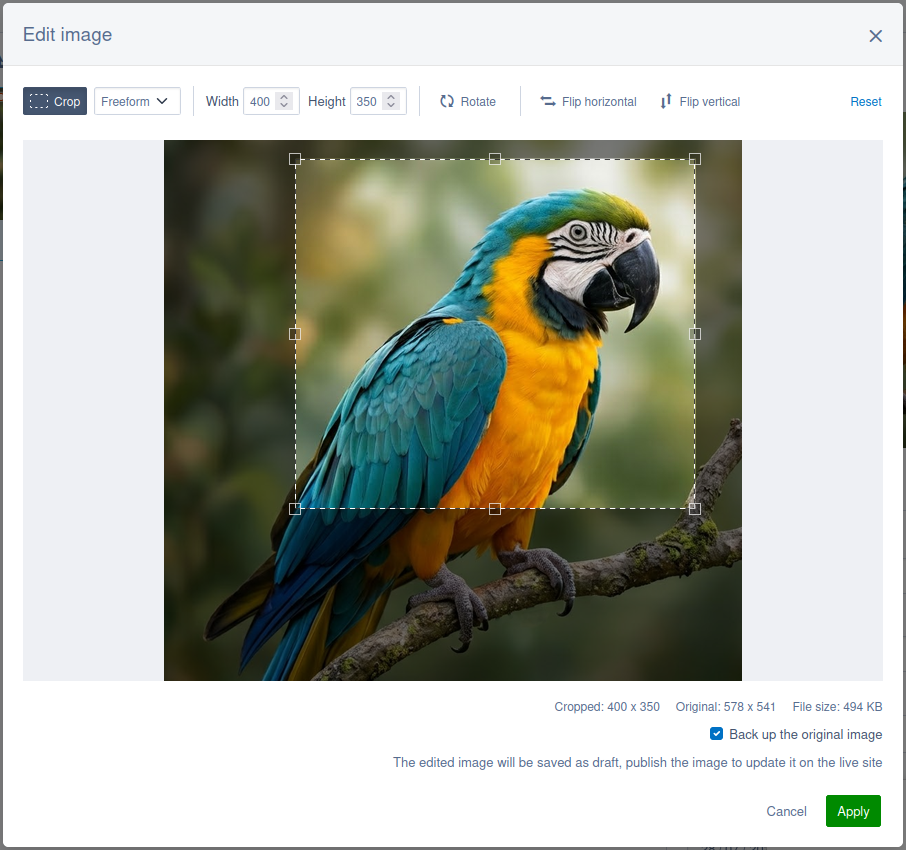

# 6.3.0

## Overview

<details>

<summary>Included module versions</summary>

<!-- markdownlint-disable enhanced-proper-names -->

| Module | Version |
| ------ | ------- |
| colymba/gridfield-bulk-editing-tools | 5.2.2 |
| dnadesign/silverstripe-elemental | 6.2.3 |
| dnadesign/silverstripe-elemental-userforms | 5.1.1 |
| silverstripe/admin | 3.3.0 |
| silverstripe/asset-admin | 3.3.0 |
| silverstripe/assets | 3.3.0 |
| silverstripe/campaign-admin | 3.3.0 |
| silverstripe/cms | 6.3.0 |
| silverstripe/config | 3.1.0 |
| silverstripe/dynamodb | 6.0.0 |
| silverstripe/environmentcheck | 4.1.0 |
| silverstripe/errorpage | 3.3.0 |
| silverstripe/framework | 6.3.0 |
| silverstripe/graphql | 6.1.1 |
| silverstripe/gridfieldqueuedexport | 4.1.1 |
| silverstripe/htmleditor-tinymce | 1.2.0 |
| silverstripe/installer | 6.3.0 |
| silverstripe/linkfield | 5.2.2 |
| silverstripe/login-forms | 6.2.1 |
| silverstripe/lumberjack | 4.1.2 |
| silverstripe/mfa | 6.2.2 |
| silverstripe/mimevalidator | 4.0.0 |
| silverstripe/realme | 6.1.0 |
| silverstripe/recipe-cms | 6.3.0 |
| silverstripe/recipe-core | 6.3.0 |
| silverstripe/recipe-kitchen-sink | 6.3.0 |
| silverstripe/recipe-plugin | 2.1.0 |
| silverstripe/reports | 6.3.0 |
| silverstripe/segment-field | 4.1.1 |
| silverstripe/session-manager | 3.1.4 |
| silverstripe/sharedraftcontent | 4.2.2 |
| silverstripe/siteconfig | 6.3.0 |
| silverstripe/spamprotection | 5.0.1 |
| silverstripe/startup-theme | 1.0.12 |
| silverstripe/staticpublishqueue | 7.0.2 |
| silverstripe/tagfield | 4.2.1 |
| silverstripe/taxonomy | 4.2.0 |
| silverstripe/template-engine | 1.0.1 |
| silverstripe/textextraction | 5.0.1 |
| silverstripe/totp-authenticator | 6.1.1 |
| silverstripe/userforms | 7.1.4 |
| silverstripe/vendor-plugin | 3.0.0 |
| silverstripe/versioned | 3.3.0 |
| silverstripe/versioned-admin | 3.3.0 |
| symbiote/silverstripe-advancedworkflow | 7.2.4 |
| symbiote/silverstripe-gridfieldextensions | 5.2.2 |
| symbiote/silverstripe-queuedjobs | 6.2.3 |
| tractorcow/silverstripe-fluent | 8.2.2 |

<!-- markdownlint-enable enhanced-proper-names -->

</details>

## Security considerations {#security-considerations}

This release includes several security fixes. Review the vulnerability disclosures for a more detailed description of each security fix. We highly encourage upgrading your project to include the latest security patches.

We have provided severity ratings of the vulnerabilities below based on the CVSS scores. Note that the impact of the vulnerabilities could vary based on the specifics of each project. You can [read the severity rating definitions in the Silverstripe CMS release process](/contributing/release_process/#severity-rating).

The following fixes are new in this release:

- [CVE-2026-91115 RCE via i18nTextCollectorTask writer parameter](https://www.silverstripe.org/download/security-releases/cve-2026-91115) Severity: High
- [SS-2026-003 RCE via renamed uploaded file](https://www.silverstripe.org/download/security-releases/ss-2026-003) Severity: High
- [CVE-2026-88991 RCE in email subject field via template execution](https://www.silverstripe.org/download/security-releases/cve-2026-88991) Severity: High
- [SS-2026-001 Template injection RCE in userforms](https://www.silverstripe.org/download/security-releases/ss-2026-001) Severity: High
- [SS-2026-006 RCE via template string escaping in userforms email subject](https://www.silverstripe.org/download/security-releases/ss-2026-006) Severity: High
- [CVE-2026-88990 RCE in email template field via template execution](https://www.silverstripe.org/download/security-releases/cve-2026-88990) Severity: High
- [SS-2026-002 Template injection RCE in advanced workflow](https://www.silverstripe.org/download/security-releases/ss-2026-002) Severity: High
- [SS-2026-007 RCE via template string escaping in advanced workflow email template](https://www.silverstripe.org/download/security-releases/ss-2026-007) Severity: High
- [CVE-2026-91112 CMS_ACCESS_SecurityAdmin privilege escalation](https://www.silverstripe.org/download/security-releases/cve-2026-91112) Severity: Medium
- [SS-2026-004 Password reset token account takeover](https://www.silverstripe.org/download/security-releases/ss-2026-004) Severity: Medium
- [CVE-2026-91110 XSS using control bytes](https://www.silverstripe.org/download/security-releases/cve-2026-91110) Severity: Medium
- [CVE-2026-91111 Uploaded XML XSS](https://www.silverstripe.org/download/security-releases/cve-2026-91111) Severity: Medium
- [CVE-2026-88987 XSS via XHTML data URI](https://www.silverstripe.org/download/security-releases/cve-2026-88987) Severity: Medium
- [CVE-2026-88988 XSS via SVG data URI](https://www.silverstripe.org/download/security-releases/cve-2026-88988) Severity: Medium
- [CVE-2026-91114 Stored XSS via unescaped permission in PermissionCheckboxSetField](https://www.silverstripe.org/download/security-releases/cve-2026-91114) Severity: Medium
- [SS-2026-005 XSS in required field label](https://www.silverstripe.org/download/security-releases/ss-2026-005) Severity: Medium
- [CVE-2026-91113 User-controlled ClassName allows unauthorized record type change](https://www.silverstripe.org/download/security-releases/cve-2026-91113) Severity: Medium
- [CVE-2026-88992 Userforms CSV export restricted file access](https://www.silverstripe.org/download/security-releases/cve-2026-88992) Severity: Medium
- [CVE-2026-88989 Auth bypass GridFieldDetailForm](https://www.silverstripe.org/download/security-releases/cve-2026-88989) Severity: Medium

As well as being included in CMS 6.3.0, these fixes were released in October 2026 as patches for earlier release lines, following our [release policy](/project_governance/release_policy/#partial-support). A release line in *partial support* only receives fixes for high and critical impact vulnerabilities, meaning those with a CVSS score of 7.0 or above, while a release line in *full support* receives fixes at any severity. The high severity fixes were released for the CMS 5.4 and 6.2 release lines, except for [CVE-2026-91115](https://www.silverstripe.org/download/security-releases/cve-2026-91115), which does not affect CMS 5 and was only released for CMS 6.2. The medium severity fixes were only released for CMS 6.2. CMS 6.1 reaches end of life with this release and does not receive any of these fixes.

The following vulnerability is disclosed in this release without a fix:

- [CVE-2026-55186 Can bypass MFA during password reset flow](https://www.silverstripe.org/download/security-releases/cve-2026-55186) Severity: Medium

This vulnerability only affects CMS 5.4, and CMS 6 is not affected. CMS 5.4 is in partial support and the vulnerability is below the severity threshold for a fix on that release line, so no patch will be released for it. Upgrade to CMS 6 to resolve it.

The following fixes were previously released as patches for earlier release lines:

- [CVE-2026-54721 Remote code execution via userforms email subject](https://www.silverstripe.org/download/security-releases/cve-2026-54721) Severity: High
- [CVE-2026-54718 Remote code execution via advanced workflow email template](https://www.silverstripe.org/download/security-releases/cve-2026-54718) Severity: High
- [CVE-2026-54717 XSS in breadcrumbs in page listview](https://www.silverstripe.org/download/security-releases/cve-2026-54717) Severity: Medium
- [CVE-2026-54720 XSS attack through media embed](https://www.silverstripe.org/download/security-releases/cve-2026-54720) Severity: Medium
- [CVE-2026-55779 ArchiveAdmin XSS](https://www.silverstripe.org/download/security-releases/cve-2026-55779) Severity: Medium

These earlier fixes were released in June 2026 under the same [release policy](/project_governance/release_policy/#partial-support). The high severity fixes were released in patches for the CMS 5.4, 6.1 and 6.2 release lines. The medium severity fixes were released in patches for the CMS 6.2 release line. See the [Silverstripe CMS security patches June 2026](https://www.silverstripe.org/blog/silverstripe-cms-security-patches-june-2026) blog post for more about these fixes, and the [Silverstripe CMS 6.3.0 blog post](https://www.silverstripe.org/blog/silverstripe-cms-630) for guidance on installing a release line that is in partial support.

### Flush required to protect the assets directory {#assets-htaccess}

The fix for [SS-2026-003](https://www.silverstripe.org/download/security-releases/ss-2026-003) hardens the `.htaccess` file that Silverstripe CMS generates in `public/assets/`, so that Apache denies direct access to PHP and other script files in that directory. An existing project only picks up the new rules once its assets store is flushed. A flush is part of most deployment processes, so for most projects this happens automatically when you deploy. If yours does not flush, run `sake db:build --flush`, `sake flush`, or a request with `?flush=1` yourself after upgrading.

The `.htaccess` file only applies to Apache. If you serve the site with another webserver such as nginx, you need to configure the equivalent protection yourself - see [webserver configuration](/developer_guides/files/file_security/#webserver-configuration) for the rules to apply. We also recommend repeating the denial in your core Apache configuration, as described on the same page, so that it still applies if the generated `.htaccess` file is missing or overridden.

### Dev task URLs ask for confirmation again {#dev-task-confirmation}

In CMS 5, opening the URL of a dev task in a browser, such as `dev/tasks/MyTask`, showed a "Confirm potentially dangerous action" screen before the task ran, unless the site was in `dev` mode. Previously in CMS 6, [`DevelopmentAdminConfirmationMiddleware`](api:SilverStripe\Control\Middleware\DevelopmentAdminConfirmationMiddleware) only asked for confirmation on URLs that exactly matched a registered dev route such as `dev/tasks`, so following a link straight to an individual task ran it immediately.

As part of the fix for [CVE-2026-91115](https://www.silverstripe.org/download/security-releases/cve-2026-91115), the middleware also asks for confirmation for URLs nested under a registered route, as it did in CMS 5.

If you trigger dev tasks by requesting their URLs from a script or scheduled job, those requests now receive the confirmation screen instead of running the task. We recommend running tasks from the command line with `sake` instead.

### `i18nTextCollectorTask` only accepts a `Writer` class name {#i18n-text-collector-writer}

As part of the fix for [CVE-2026-91115](https://www.silverstripe.org/download/security-releases/cve-2026-91115), the `writer` option of [`i18nTextCollectorTask`](api:SilverStripe\Dev\Tasks\i18nTextCollectorTask) now only accepts the name of a class that implements [`Writer`](api:SilverStripe\i18n\Messages\Writer), and throws an `InvalidArgumentException` for any other value, including an injector service name.

### Email fields in `silverstripe/userforms` and `symbiote/silverstripe-advancedworkflow` no longer evaluate template syntax {#form-email-template-injection}

The subject and body of a user defined form email recipient (handled by [`UserDefinedFormController`](api:SilverStripe\UserForms\Control\UserDefinedFormController) in `silverstripe/userforms`), and the email template of a [`NotifyUsersWorkflowAction`](api:Symbiote\AdvancedWorkflow\Actions\NotifyUsersWorkflowAction) in `symbiote/silverstripe-advancedworkflow`, are edited by CMS authors and were previously rendered through the full template engine. Templates are compiled to PHP and can call methods on arbitrary objects, so an author could have put template code in those fields that ran on the server when the email was sent - for example to change another user's password or to write a PHP file.

[CVE-2026-88991](https://www.silverstripe.org/download/security-releases/cve-2026-88991), [SS-2026-001](https://www.silverstripe.org/download/security-releases/ss-2026-001) and [SS-2026-006](https://www.silverstripe.org/download/security-releases/ss-2026-006) in `silverstripe/userforms`, and [CVE-2026-88990](https://www.silverstripe.org/download/security-releases/cve-2026-88990), [SS-2026-002](https://www.silverstripe.org/download/security-releases/ss-2026-002) and [SS-2026-007](https://www.silverstripe.org/download/security-releases/ss-2026-007) in `symbiote/silverstripe-advancedworkflow`, are separate vulnerabilities that each reach code execution because these fields were rendered as templates, and are all fixed by no longer rendering these fields as templates. The fields now substitute a known set of variables and leave everything else as literal text. In `silverstripe/userforms` that is the submitted form values, referenced as `$FieldName` or `{$FieldName}`. In `symbiote/silverstripe-advancedworkflow` it is the notification variables the action already exposes, such as `$Member.FirstName`, `$Context.Title`, `$Assignee.Email`, and `$CommentHistory`, in either bare or braced form. In both modules, values substituted into an HTML email body are escaped as before.

These are not the first vulnerabilities in these fields. [CVE-2026-54721](https://www.silverstripe.org/download/security-releases/cve-2026-54721) and [CVE-2026-54718](https://www.silverstripe.org/download/security-releases/cve-2026-54718), released in June 2026, let an author run PHP through a `<%t %>` translation string in the same fields. Their fix changed the template parser, but left the fields rendered as templates, which is what the new fixes address.

Control structures and casting methods that the template engine used to process here, such as an `<% if %>` or `<% loop %>` block or a modifier like `$FieldName.LimitCharacters`, now appear verbatim in the sent email. If a project put template logic in any of these fields, rewrite it to use only the supported variables. If you need conditional or looping logic in a `silverstripe/userforms` email, put it in a developer-controlled HTML email template, which the recipient can select and which is still rendered as a template - see [send email as plain text](https://userhelp.silverstripe.org/en/6/optional_features/userforms/form-submissions/#send-email-as-plain-text).

If you need your own variables in these fields, register them from an [extension](/developer_guides/extending/extensions/). In `silverstripe/userforms`, add to the merge-field map from an `updateMergeFields()` method - a dotted name such as `SiteConfig.Title` is supported, so previously used tokens can be re-added:

```php
// app/src/Extensions/FormEmailMergeFieldsExtension.php
namespace App\Extensions;

use SilverStripe\Core\Extension;
use SilverStripe\Model\ArrayData;

class FormEmailMergeFieldsExtension extends Extension
{
    protected function updateMergeFields(ArrayData $mergeFields, $recipient, $submittedForm): void
    {
        $mergeFields->setField('MyVariable', 'my value');
    }
}
```

In `symbiote/silverstripe-advancedworkflow`, add to the notification variables from an `updateNotificationVariables()` method. The array starts empty, and its entries are merged over the action's own variables, so a custom variable with the same name as a built-in one replaces it:

```php
// app/src/Extensions/WorkflowNotificationVariablesExtension.php
namespace App\Extensions;

use SilverStripe\Core\Extension;

class WorkflowNotificationVariablesExtension extends Extension
{
    protected function updateNotificationVariables(array &$customVariables, $workflow): void
    {
        $customVariables['$MyVariable'] = 'my value';
    }
}
```

Apply each extension to its controller or action through [configuration](/developer_guides/extending/extensions/):

```yml
# app/_config/email-field-extensions.yml
SilverStripe\UserForms\Control\UserDefinedFormController:
  extensions:
    - App\Extensions\FormEmailMergeFieldsExtension
Symbiote\AdvancedWorkflow\Actions\NotifyUsersWorkflowAction:
  extensions:
    - App\Extensions\WorkflowNotificationVariablesExtension
```

The registered values are substituted as literal text and are never evaluated as a template. In an HTML email body a plain string value is escaped - pass a `DBField` instance if you need to control the casting.

### Action may be required for groups that grant privileged permissions {#group-privileged-permissions}

Previously, [`Group::canEdit()`](api:SilverStripe\Security\Group::canEdit()) looked only for permission codes assigned directly to the group. A user with the `CMS_ACCESS_SecurityAdmin` permission could therefore edit a group whose members receive privileged permissions through an assigned [`PermissionRole`](api:SilverStripe\Security\PermissionRole), or by inheritance from a parent group. The parent group check in [`Group::validate()`](api:SilverStripe\Security\Group::validate()) likewise ignored permissions granted through a role.

As part of the fix for [CVE-2026-91112](https://www.silverstripe.org/download/security-releases/cve-2026-91112), both now resolve the permissions a member of the group would actually receive, whether those are assigned to the group directly, granted through a role, or inherited from an ancestor group. `Group::canEdit()` also now covers `APPLY_ROLES` as well as `ADMIN`, since a user holding `APPLY_ROLES` can assign an existing role that grants `ADMIN`.

A user without the `ADMIN` permission can no longer edit a group that grants `ADMIN` or `APPLY_ROLES` to its members, and can no longer move a group underneath a group granting a [privileged permission](api:SilverStripe\Security\Permission->privileged_permissions). Groups granting `EDIT_PERMISSIONS` remain editable, so a delegated security administrator can still manage them. If your project relies on `CMS_ACCESS_SecurityAdmin` users administering groups that grant `ADMIN` or `APPLY_ROLES`, we recommend granting those users `ADMIN`, or restructuring the groups so they no longer confer those permissions.

<!-- markdownlint-disable title-case-style -->
### XML and SVG data URIs removed from HTML content {#xml-svg-data-uris}
<!-- markdownlint-enable title-case-style -->

The fixes for [CVE-2026-88987](https://www.silverstripe.org/download/security-releases/cve-2026-88987) and [CVE-2026-88988](https://www.silverstripe.org/download/security-releases/cve-2026-88988) change [`XssSanitiser`](api:SilverStripe\Core\XssSanitiser) so that it removes the `src`, `lowsrc`, `href` and `data` attributes from an element when the attribute value is a data URI with one of these media types, as it already did for `data:text/html`:

- `data:application/xhtml+xml`, `data:text/xml` and `data:application/xml`. An XML document whose root element is in the XHTML namespace is parsed as XHTML by the browser, which executes any inline `<script>` the document contains.
- `data:image/svg+xml`, and any other media type starting with `data:image/svg`. An SVG is a document that can carry script.

This applies to content saved through the WYSIWYG editor, which is sanitised by [`HTMLEditorSanitiser`](api:SilverStripe\Forms\HTMLEditor\HTMLEditorSanitiser). The media type alone determines whether the attribute is removed - the contents of the data URI are not inspected, so a `data:text/xml` URI which contains no script is removed as well. Data URIs for other image types, such as `data:image/png`, are left alone.

This includes ``. An SVG referenced by an `` element is rendered with scripting disabled, so that case does not execute anything on its own, but it is removed as well because nothing stops the same value being moved into an attribute that does execute it.

HTML is sanitised when it is saved rather than when it is rendered, so upgrading does not rewrite content you have already stored. If existing content contains an inline SVG image, that image is removed the next time an author saves the record it belongs to. We recommend replacing any such image with an uploaded file before that happens. References to `.svg` files in the asset store are not affected by this change. Those are governed by [`File.allowed_extensions`](api:SilverStripe\Assets\File->allowed_extensions), which does not include `svg` by default.

### Protected files are served with a content disposition {#file-content-disposition}

As part of the fix for [CVE-2026-91111](https://www.silverstripe.org/download/security-releases/cve-2026-91111), files that the asset store serves through PHP, such as draft files and `silverstripe/userforms` submission uploads, are now sent with a `Content-Disposition` header. Only content types listed in [`FlysystemAssetStore.inline_content_types`](api:SilverStripe\Assets\Flysystem\FlysystemAssetStore->inline_content_types) are served as `inline`. Everything else is served as `attachment` and downloads rather than rendering in the browser. Content types listed in [`FlysystemAssetStore.forbidden_inline_content_types`](api:SilverStripe\Assets\Flysystem\FlysystemAssetStore->forbidden_inline_content_types) are always served as `attachment`, even when they match an entry in the allowlist.

The defaults are:

```yml
SilverStripe\Assets\Flysystem\FlysystemAssetStore:
  inline_content_types:
    - 'image/*'
    - 'audio/*'
    - 'video/*'
    - 'application/pdf'
    - 'text/plain'
  forbidden_inline_content_types:
    # Matches "image/*" but can carry an inline <script>
    - 'image/svg+xml'
```

The content type is detected from the file's contents, falling back to the file extension when the contents are inconclusive. A CSV file is detected as `text/csv` from its extension, for example, rather than as the `text/plain` its contents resemble, so it downloads. Markup that a browser could execute, such as SVG or HTML, is always detected from the contents, so renaming such a file does not change how it is served.

[`FlysystemAssetStore.file_response_headers`](api:SilverStripe\Assets\Flysystem\FlysystemAssetStore->file_response_headers) now also includes `X-Content-Type-Options: nosniff` and `Content-Security-Policy: default-src 'none'; sandbox`. If you have overridden that configuration property in your own YAML you are replacing the whole array, and we recommend adding both headers to your override.

Projects using the default [`File.allowed_extensions`](api:SilverStripe\Assets\File->allowed_extensions) need do nothing. With those defaults, archive, office document and CSV files change from inline to downloading, which is what browsers already did with them. XML-based files such as KML, which browsers previously displayed as XML, now download as well. If you have added extensions such as `svg`, `html` or `json`, files with those content types now download when opened directly. Files embedded in a page are unaffected, because browsers ignore `Content-Disposition` for images and media loaded as subresources. We recommend adding any content type you need to render inline to `inline_content_types`.

### Markup in `silverstripe/userforms` required field labels is no longer rendered {#userforms-required-label-escaping}

`silverstripe/userforms` appends an identifier to the label of every required field when the [`UserDefinedForm.required_identifier`](api:SilverStripe\UserForms\Model\UserDefinedForm->required_identifier) configuration property is set. Previously, building that label cast the field title to raw HTML, so markup a content author entered as a field title was rendered as HTML on the public form. As part of the fix for [SS-2026-005](https://www.silverstripe.org/download/security-releases/ss-2026-005), the title is now escaped before the identifier is appended.

This only affects sites that set `required_identifier`, which is unset by default. On those sites, a field title containing markup such as `<strong>` or a link previously rendered as HTML and now renders as visible text. Without `required_identifier` the title was already escaped, so the same title now renders the same way whether or not that configuration property is set.

If you relied on markup in a field title, we recommend moving that content into the field's description or elsewhere on the page.

### Creating records through a `GridFieldDetailForm` enforces create permission {#gridfield-create-permission}

As part of the fix for [CVE-2026-88989](https://www.silverstripe.org/download/security-releases/cve-2026-88989), saving a new record through [`GridFieldDetailForm`](api:SilverStripe\Forms\GridField\GridFieldDetailForm) now calls `canCreate()` on that record and returns a 403 response when it fails, matching the check already applied to the "Add" button. Previously the permission was only checked when rendering the button, so a crafted request could reach the save handler directly and create a record the member was not permitted to create.

No action is required for projects whose `canCreate()` implementations already reflect who may create each record. If you have a `GridFieldDetailForm` for a model whose `canCreate()` returns `false` for members who were previously able to add records through it, those members will now receive a 403 response when saving. Update the model's `canCreate()` to grant the permission if that creation should be allowed.

### Action may be required for media embeds {#media-embed-sandboxing}

The fix for [CVE-2026-54720](https://www.silverstripe.org/download/security-releases/cve-2026-54720) now removes all but a known-safe set of attributes, such as `src`, `width`, `height` and `allow`, from an `<iframe>` returned by an oEmbed provider when that iframe is added to the page as-is rather than wrapped in a sandbox. Removed attributes include event handlers, `style` and `class`. If this breaks a legitimate embed, you can exempt a fully trusted provider's domain with the [`EmbedShortcodeProvider.domains_excluded_from_sandboxing`](api:SilverStripe\View\Shortcodes\EmbedShortcodeProvider->domains_excluded_from_sandboxing) configuration property, so its embeds are left exactly as the provider sends them:

```yml
# app/_config/embed.yml
SilverStripe\View\Shortcodes\EmbedShortcodeProvider:
  domains_excluded_from_sandboxing:
    - trusted-provider.com
```

The domain is matched by suffix, so the value above also matches subdomains such as `embed.trusted-provider.com` - and any other domain ending in the same string, including an unrelated `nottrusted-provider.com`. Give the full domain, so you don't match a domain you don't control.

Embeds from an excluded domain render exactly as the provider sends them, and are no longer wrapped in a sandboxed iframe, so only add domains you fully trust. See [sandboxing oembed HTML](/developer_guides/forms/field_types/htmleditorfield/#sandboxing-oembed-html) for more about how sandboxing works.

## Features and enhancements

### Image editing {#image-editing}

Content authors can now make simple composition changes to images without leaving the CMS: crop, rotate in 90 degree steps, flip horizontally or vertically, and resize.

In the "Files" section, click an image to open its detail view, then click the "Other actions" button - the three dots next to "Save" and "Publish" - and select "Edit image". The action only appears for raster images you have permission to edit.



The editor is focused on image composition (where the subject sits in the frame) rather than retouching i.e. there are no brightness, colour, filter, or background removal controls.

Note the following behaviours:

- **The original file is replaced in place.** Applying an edit writes the rendered result over the origin file. The record keeps its ID, folder, and filename, so everything already using that image picks up the edited pixels with nothing to repoint.
- **The original can be backed up first.** A checkbox in the editor - ticked by default - copies the pre-edit bytes into a new draft file in the same folder before the replacement is written, named by the CMS's usual de-duplication, so `beach.jpg` is backed up as `beach-v2.jpg`. Untick it and the original bytes are gone for good.
- **The edit is saved as a draft.** The published version of the file is untouched, so the live site keeps serving the pre-edit image until you publish it yourself.
- **Resizing keeps the aspect ratio.** Type a width or a height and the other is derived. The output can only be made smaller than the cropped image, never larger.
- **Raster images only.** SVG files are not editable through the image editor.

Being able to edit an image requires permission to edit the original - its bytes are modified - and permission to create files in the folder it lives in, for the backup copy.

Edited images are encoded in the same format as their source, at the same quality used for [resampled images](/developer_guides/files/images/#resampled-image-quality), or at a quality you configure for the editor alone.

Extension hooks are called either side of each write the editor makes, so you can alter the rendered image before it is saved - to add a watermark, for example - or react once it has been.

See [image editor](/developer_guides/customising_the_admin_interface/image_editor/) for the rest of the configuration options.

### React class components converted to functional components {#react-functional-components}

Form field components in the CMS have been converted from React class components to functional components. This is part of an ongoing modernisation effort - functional components are simpler, have better tooling support, and align with current React best practices.

For most projects this change is invisible. However, if your project extends any of these components as an ES6 class (`extends TextField`), that pattern will no longer work because functional components cannot be subclassed.

To ease migration, the original class-based implementations are preserved as `Legacy`-prefixed copies in `client/src/legacy/ReactComponents/`. Only class components that were previously defined in the [`client/src/bundles/bundle.js`](https://github.com/silverstripe/silverstripe-admin/blob/3.2/client/src/bundles/bundle.js) file in `silverstripe/admin`, or were a parent class of an exported component, are available as legacy components. If your project subclasses a converted component, update the import to use the legacy version:

Before:

```js
import TextField from 'components/TextField/TextField';

class MyCustomField extends TextField {
  // ...
}
```

After:

```js
import LegacyTextField from 'legacy/ReactComponents/LegacyTextField';

class MyCustomField extends LegacyTextField {
  // ...
}
```

You will need the latest version of [@silverstripe/webpack-config](https://www.npmjs.com/package/@silverstripe/webpack-config) to use the legacy components, which includes an updated externals configuration to support the new import paths.

Note that these legacy class components are provided as a short-term migration aid and will be removed in CMS 7. Projects should plan to move away from class inheritance before then.

The new functional components provide exports (for example `getInputProps()`, `handleChange()`, and `render()`) that were previously provided via class inheritance. If you previously extended class components, migrate to functional components by composing the exported helpers in your own components.

## API changes

### Deprecated API

The following API has been deprecated in this release, and will be removed or replaced in a future major release.

It's best practice to avoid using deprecated code where possible, but sometimes it's unavoidable. This API will all continue to be available at least until the next major release.

- The [`NotifyUsersWorkflowAction.whitelist_template_variables`](api:Symbiote\AdvancedWorkflow\Actions\NotifyUsersWorkflowAction->whitelist_template_variables) configuration property has been deprecated. It has no effect now that email notification bodies no longer evaluate template syntax (see [email fields no longer evaluate template syntax](#form-email-template-injection)), so remove it from your project configuration.

## Bug fixes

This release includes a number of bug fixes to improve a broad range of areas. Check the change logs for full details of these fixes split by module. Thank you to the community members that helped contribute these fixes as part of the release!

### SingleRecordAdmin permission generation {#singlerecordadmin-permissions}

Previously, [`SingleRecordAdmin`](api:SilverStripe\Admin\SingleRecordAdmin) subclasses did not generate CMS access permissions in the way that [`ModelAdmin`](api:SilverStripe\Admin\ModelAdmin) subclasses did. This meant it was difficult to grant non-admin users access to custom `SingleRecordAdmin` sections through the CMS security permissions interface - they were only visible to users with administrator privileges without adding custom code.

We've now updated the permission generation system in [`LeftAndMain::providePermissions()`](api:SilverStripe\Admin\LeftAndMain::providePermissions()) to include both `ModelAdmin` and `SingleRecordAdmin` subclasses. Any custom `SingleRecordAdmin` implementation will now automatically generate a permission that allows you to control access via groups and roles, just as you would for `ModelAdmin` sections. By default these permissions will be disabled for non-admin users, so you will need to explicitly grant access to the relevant user groups via the CMS.

If you have a custom `SingleRecordAdmin` that should not appear in the permissions interface, set the [`LeftAndMain.skip_permission_generation`](api:SilverStripe\Admin\LeftAndMain->skip_permission_generation) configuration property value to `true`:

```php
namespace App\Admins;

class MySpecialAdmin extends SingleRecordAdmin
{
    private static bool $skip_permission_generation = true;
    // ...
}
```

### `DoormanRunner` service name now gets the default process limit {#doorman-runner-default-rules}

Previously, if you configured `symbiote/silverstripe-queuedjobs` to run jobs with the [`DoormanRunner`](api:Symbiote\QueuedJobs\Tasks\Engines\DoormanRunner) by its `DoormanRunner` service name - `'%$DoormanRunner'`, as [configuring runners](/optional_features/queuedjobs/configuring-runners/#doorman) shows - the runner did not get its default rules, so Doorman ran job processes with no limit. Referencing the runner by its full class name was not affected.

The `DoormanRunner` service name is now a reference to the `Symbiote\QueuedJobs\Tasks\Engines\DoormanRunner` service, so it gets the default rule, which runs one job process at a time. If your project relied on running jobs in parallel, raise the limit on the `DefaultRule` service:

```yml
SilverStripe\Core\Injector\Injector:
  DefaultRule:
    properties:
      # The number of job processes Doorman can run at the same time
      Processes: 4
```

If your project sets properties on the `DoormanRunner` service name, for example `DefaultRules` as the [multi process execution in Doorman](/optional_features/queuedjobs/performance/#multi-doorman) example currently does, move them to the `Symbiote\QueuedJobs\Tasks\Engines\DoormanRunner` service name. Configuration under `DoormanRunner` now replaces the reference, so any use of the queued jobs service fails with "Class DoormanRunner does not exist".

When you move your own `DefaultRules`, key each rule by name and set `DefaultRule` to `null`. A plain list of rules is added to the module's `DefaultRule` instead of replacing it, and that rule still limits Doorman to one process:

```yml
SilverStripe\Core\Injector\Injector:
  Symbiote\QueuedJobs\Tasks\Engines\DoormanRunner:
    properties:
      DefaultRules:
        # Remove the module's default rule, which limits Doorman to one process
        DefaultRule: null
        # Your own rules, keyed by name - each must be a rule service your project defines
        MyLowUsageRule: '%$MyLowUsageRule'
        MyHighUsageRule: '%$MyHighUsageRule'
```

Only set `DefaultRule` to `null` when you add rules of your own. With no rules, Doorman has no process limit.

This fix was also released in `symbiote/silverstripe-queuedjobs` 6.2.3.

<!--- Changes below this line will be automatically regenerated -->
<!-- markdownlint-disable proper-names enhanced-proper-names -->## Full commits list

<details>
<summary>Reveal full list of commits</summary>

### Security {#changelog-security}

- silverstripe/assets (3.2.0 -&gt; 3.3.0)
  - 2026-10-28 [ae68af6](https://github.com/silverstripe/silverstripe-assets/commit/ae68af680c1458c1cc1c05b2ad7ebc36bcd43e17) [SS-2026-003] RCE via renamed uploaded file (#719) (Steve Boyd) - See [ss-2026-003](https://www.silverstripe.org/download/security-releases/ss-2026-003)

- silverstripe/framework (6.2.0 -&gt; 6.3.0)
  - 2026-10-28 [693c948ba](https://github.com/silverstripe/silverstripe-framework/commit/693c948bae13dd2a854489baa575123ca3e60155) Auth bypass GridFieldDetailForm (#12043) (Steve Boyd) - See [cve-2026-88989](https://www.silverstripe.org/download/security-releases/cve-2026-88989)
  - 2026-10-28 [8b6e9c451](https://github.com/silverstripe/silverstripe-framework/commit/8b6e9c4514cbe37feeaf9ddddf796a3109448187) User-controlled ClassName allows unauthorized record type change (#12042) (Steve Boyd) - See [cve-2026-91113](https://www.silverstripe.org/download/security-releases/cve-2026-91113)
  - 2026-10-28 [3ac8440a3](https://github.com/silverstripe/silverstripe-framework/commit/3ac8440a3accc04e5dbca1a41513d628920e58c2) Stored XSS via unescaped permission in PermissionCheckboxSetField (#12041) (Steve Boyd) - See [cve-2026-91114](https://www.silverstripe.org/download/security-releases/cve-2026-91114)
  - 2026-10-28 [9b61e6d04](https://github.com/silverstripe/silverstripe-framework/commit/9b61e6d04da1a3183c4ef4081cb64fd31ae0701f) XSS via SVG data URI (#12040) (Steve Boyd) - See [cve-2026-88988](https://www.silverstripe.org/download/security-releases/cve-2026-88988)
  - 2026-10-28 [cea9c46eb](https://github.com/silverstripe/silverstripe-framework/commit/cea9c46eba4be31a06adf6980494623385e1296d) XSS via XHTML data URI (#12039) (Steve Boyd) - See [cve-2026-88987](https://www.silverstripe.org/download/security-releases/cve-2026-88987)
  - 2026-10-28 [dbf965166](https://github.com/silverstripe/silverstripe-framework/commit/dbf965166da909739a197c95b27dd9ee2fde93c9) XSS using control bytes (#12038) (Steve Boyd) - See [cve-2026-91110](https://www.silverstripe.org/download/security-releases/cve-2026-91110)
  - 2026-10-28 [06e668db0](https://github.com/silverstripe/silverstripe-framework/commit/06e668db01050895bb7e767fbf0b368c1081f479) [SS-2026-004] Password reset token account takeover (#12037) (Steve Boyd) - See [ss-2026-004](https://www.silverstripe.org/download/security-releases/ss-2026-004)
  - 2026-10-28 [bb4d04a49](https://github.com/silverstripe/silverstripe-framework/commit/bb4d04a498c34e21e428d029c4ce82bbdcce31b1) `CMS_ACCESS_SecurityAdmin privilege escalation` (Steve Boyd) - See [cve-2026-91112](https://www.silverstripe.org/download/security-releases/cve-2026-91112)
  - 2026-09-01 [ff532b046](https://github.com/silverstripe/silverstripe-framework/commit/ff532b046920e78f5eb3c678ca1a57442962e270) RCE via i18nTextCollectorTask writer parameter (Steve Boyd) - See [cve-2026-91115](https://www.silverstripe.org/download/security-releases/cve-2026-91115)
  - 2026-06-24 [1bcb02adf](https://github.com/silverstripe/silverstripe-framework/commit/1bcb02adfc365c6436dc26ab2f6dd32d97f3979b) Remove on attributes from iframe embeds (#11993) (Steve Boyd) - See [cve-2026-54720](https://www.silverstripe.org/download/security-releases/cve-2026-54720)

- silverstripe/cms (6.2.0 -&gt; 6.3.0)
  - 2026-06-24 [62f9912b](https://github.com/silverstripe/silverstripe-cms/commit/62f9912baa18c80304f3fa8b6eca71bb5dc2d21e) Escape page titles in breadcrumbs for page list view (#3175) (Steve Boyd) - See [cve-2026-54717](https://www.silverstripe.org/download/security-releases/cve-2026-54717)

- silverstripe/versioned (3.2.0 -&gt; 3.3.0)
  - 2026-06-15 [6e30a2c](https://github.com/silverstripe/silverstripe-versioned/commit/6e30a2cf8d4b9233690464da61bd0fc4d3e92952) XSS in RestoreAction message (Steve Boyd) - See [cve-2026-55779](https://www.silverstripe.org/download/security-releases/cve-2026-55779)

- silverstripe/userforms (7.1.0 -&gt; 7.1.4)
  - 2026-10-28 [4d752ea](https://github.com/silverstripe/silverstripe-userforms/commit/4d752ea8f3e26a6423e90b7d07c92ae69f96ec2c) Userforms CSV export restricted file access (#1464) (Steve Boyd) - See [cve-2026-88992](https://www.silverstripe.org/download/security-releases/cve-2026-88992)
  - 2026-10-28 [a2bd92d](https://github.com/silverstripe/silverstripe-userforms/commit/a2bd92d77f094e414258cd0e66e596a184c50bd0) Uploaded XML XSS (#1465) (Steve Boyd) - See [cve-2026-91111](https://www.silverstripe.org/download/security-releases/cve-2026-91111)
  - 2026-10-28 [ab4eb7d](https://github.com/silverstripe/silverstripe-userforms/commit/ab4eb7d1a13bf654ffe24f0218e6c645fa443a9e) [SS-2026-001] Template injection RCE in userforms (#1462) (Steve Boyd) - See [ss-2026-001](https://www.silverstripe.org/download/security-releases/ss-2026-001)
  - 2026-10-28 [bc96ea4](https://github.com/silverstripe/silverstripe-userforms/commit/bc96ea4af2d5eb026f739c4b36a36c2244caca57) [SS-2026-005] XSS in required field label (#1463) (Steve Boyd) - See [ss-2026-005](https://www.silverstripe.org/download/security-releases/ss-2026-005)
  - 2026-06-24 [c55494a](https://github.com/silverstripe/silverstripe-userforms/commit/c55494ad7c717b199a3c1663b43a54db5d95604c) Prevent RCE via email recipient subject (#1442) (Steve Boyd) - See [cve-2026-54721](https://www.silverstripe.org/download/security-releases/cve-2026-54721)
  - 2026-06-24 [23c0698](https://github.com/silverstripe/silverstripe-userforms/commit/23c069866900c19b499bfa997d1e251e97491702) Prevent RCE via email recipient subject (#1441) (Steve Boyd) - See [cve-2026-54721](https://www.silverstripe.org/download/security-releases/cve-2026-54721)

- symbiote/silverstripe-advancedworkflow (7.2.0 -&gt; 7.2.4)
  - 2026-10-28 [de6f534](https://github.com/silverstripe/silverstripe-advancedworkflow/commit/de6f534a3f189fb77d2b2654719058da4aff7420) [SS-2026-002] Template injection RCE in advanced workflow (#639) (Steve Boyd) - See [ss-2026-002](https://www.silverstripe.org/download/security-releases/ss-2026-002)
  - 2026-06-24 [f170766](https://github.com/silverstripe/silverstripe-advancedworkflow/commit/f170766af992ed2ed3e5f21d127d0d0d3129678b) Prevent RCE via notification email template (#630) (Steve Boyd) - See [cve-2026-54718](https://www.silverstripe.org/download/security-releases/cve-2026-54718)
  - 2026-06-24 [28d0b53](https://github.com/silverstripe/silverstripe-advancedworkflow/commit/28d0b536491e5c68b1c445579bdd1ddc8beaf8bb) Prevent RCE via notification email template (#629) (Steve Boyd) - See [cve-2026-54718](https://www.silverstripe.org/download/security-releases/cve-2026-54718)

### Features and enhancements {#changelog-features-and-enhancements}

- silverstripe/assets (3.2.0 -&gt; 3.3.0)
  - 2026-10-28 [88750f9](https://github.com/silverstripe/silverstripe-assets/commit/88750f95e8eafcae6ce41bc131056ca75d960d7f) Force user uploaded XML-like files to be downloaded (#720) (Steve Boyd)

- silverstripe/admin (3.2.0 -&gt; 3.3.0)
  - 2026-02-23 [c3721e68](https://github.com/silverstripe/silverstripe-admin/commit/c3721e68c694ad55d986554653d567a8b0878c36) Convert more admin components to functional (Steve Boyd)

- silverstripe/asset-admin (3.2.0 -&gt; 3.3.0)
  - 2026-07-31 [3f2318cf](https://github.com/silverstripe/silverstripe-asset-admin/commit/3f2318cfe56b3491e893356a6dbf5daaa0fd8f17) Basic image editing (#1693) (Steve Boyd)

- silverstripe/htmleditor-tinymce (1.1.0 -&gt; 1.2.0)
  - 2026-02-23 [ccb587c](https://github.com/silverstripe/silverstripe-htmleditor-tinymce/commit/ccb587c3bcedd2ae2c593edd37d95f728595c0f2) Convert TinyMceHtmlEditorField to functional component (Steve Boyd)

### Bugfixes {#changelog-bugfixes}

- silverstripe/assets (3.2.0 -&gt; 3.3.0)
  - 2026-08-13 [045538b](https://github.com/silverstripe/silverstripe-assets/commit/045538be37b53facb8022cc459bdc136fc418fc4) `Resolve relative paths when using SS_PROTECTED_ASSETS_PATH` (Steve Boyd)

- silverstripe/framework (6.2.0 -&gt; 6.3.0)
  - 2026-10-15 [5eb5e6f36](https://github.com/silverstripe/silverstripe-framework/commit/5eb5e6f364082cc1c22f7d70513b3f1504ede2ff) Render logged errors without an error number on PHP 8.5 (Lianna Gonlag)
  - 2026-10-02 [fef743f4d](https://github.com/silverstripe/silverstripe-framework/commit/fef743f4daa7656c242b569d661c8b6420a3ad9c) Catch empty string values for duplicate entries (#12027) (Chloe Sartorelli)
  - 2026-09-24 [94a0f8300](https://github.com/silverstripe/silverstripe-framework/commit/94a0f830000b321d5fbf0aed7975f40ffc3e894f) Accept a leading backslash in ClassManifest::getItemPath() (micschk)
  - 2026-09-24 [da199ff56](https://github.com/silverstripe/silverstripe-framework/commit/da199ff56f849cc0c258f1670afa17921579d0e4) Prompt for confirmation on tasks (Steve Boyd)
  - 2026-09-16 [a846a9a1d](https://github.com/silverstripe/silverstripe-framework/commit/a846a9a1d87cb808d0b34bde2d47ebcdbd476494) Exclude vendor/composer from manifest scanning (Lukas Erni)
  - 2026-09-03 [a98817d4a](https://github.com/silverstripe/silverstripe-framework/commit/a98817d4a963f8a5c8a5c6d0902464531ed73710) SSViewer::rewriteHashLinks with trailing slash (#12006) (Steve Boyd)
  - 2026-08-31 [789c3fa33](https://github.com/silverstripe/silverstripe-framework/commit/789c3fa3399d5126b62b4861778046efeee1895d) isQueryType fails when sql starts with whitespace (Dominik Beerbohm)
  - 2026-08-29 [ad848b06b](https://github.com/silverstripe/silverstripe-framework/commit/ad848b06b9b68b312cd4f56893338a3729cf4a39) `Guard against overriding &quot;size&quot; attribute (#12011)` (Nicola Fontana)
  - 2026-08-16 [21f731780](https://github.com/silverstripe/silverstripe-framework/commit/21f73178081f563f14fd6a3b19abd700d79d22cb) Resolve table class when multiple modifiers are appended (Robbie Averill)
  - 2026-08-11 [30c45de4e](https://github.com/silverstripe/silverstripe-framework/commit/30c45de4e448a7f82c1ac771b339729d34269d67) deprecation warning in RequiredFieldsValidator when validating a field without name (#11982) (Florian Thoma)
  - 2026-06-24 [7801ad0b4](https://github.com/silverstripe/silverstripe-framework/commit/7801ad0b4edca44239f27e6c6e40550b25b55b64) Prevent RCE via translation default strings (#11994) (Steve Boyd)
  - 2026-06-23 [3a41d5108](https://github.com/silverstripe/silverstripe-framework/commit/3a41d5108b2c4956b24c6318227d4edf0ec2252d) Correct hex escape pattern in i18nTextCollector (#11991) (Steve Boyd)
  - 2026-04-28 [8582b8a2d](https://github.com/silverstripe/silverstripe-framework/commit/8582b8a2d87f2942eaf9f6618e054a9e086ad157) Director::hostName() returning null for bare hostnames (Erik Frèrejean)
  - 2026-03-17 [1d3692983](https://github.com/silverstripe/silverstripe-framework/commit/1d36929832ad1967241efbe970bc92e8f80841f2) code example in doc block (#11976) (Stefan Eickhoff)

- silverstripe/template-engine (1.0.0 -&gt; 1.0.1)
  - 2026-06-24 [e4f5f4e](https://github.com/silverstripe/silverstripe-template-engine/commit/e4f5f4e1e881ebf33acdd6071dc41b393cacdf63) Prevent RCE via translation default strings (Steve Boyd)

- silverstripe/admin (3.2.0 -&gt; 3.3.0)
  - 2026-10-15 [ee821cc1](https://github.com/silverstripe/silverstripe-admin/commit/ee821cc1ad4c94274a953258077cb8c609feb166) Quote ID so additional characters are allowed (#2211) (Chloe Sartorelli)
  - 2026-10-09 [5db64e65](https://github.com/silverstripe/silverstripe-admin/commit/5db64e65677b7ff80b85f21bb6ed9f4bae9b4084) Correctly hydrate declarative shadow DOM with PJAX (#2196) (Chloe Sartorelli)
  - 2026-09-08 [c44b28d4](https://github.com/silverstripe/silverstripe-admin/commit/c44b28d4f95200ba7d9ea2c0462f768442af2672) Skip non-element nodes in entwine matching (comment nodes) (Kiro)
  - 2026-09-07 [ab6d7e5d](https://github.com/silverstripe/silverstripe-admin/commit/ab6d7e5d8b826d661a497d3bc48e1612715d2773) update webpack config to strip BOMs from compiled css (Andrew Paxley)
  - 2026-08-27 [d21155ec](https://github.com/silverstripe/silverstripe-admin/commit/d21155ec86fd9bfceeddbba57a3db5b2b5fc019e) Mark every enclosing tab when a nested tabset holds a validation error (Ed Wilde)
  - 2026-08-24 [8d5732fb](https://github.com/silverstripe/silverstripe-admin/commit/8d5732fb51b18e22637badcf8f653e12916af0e9) Stop single record admins reading ID from request (Steve Boyd)
  - 2026-08-12 [2f514ac6](https://github.com/silverstripe/silverstripe-admin/commit/2f514ac63f7231495af35df869f287109491eb64) Open deep-linked sitetree pages (Steve Boyd)
  - 2026-06-10 [129a407b](https://github.com/silverstripe/silverstripe-admin/commit/129a407bd29d69472b8ba767f34b28abf2097b68) Strip Content-Type parameters before matching in Backend.js decode() (#2140) (Steve Boyd)
  - 2026-06-09 [5ff3c732](https://github.com/silverstripe/silverstripe-admin/commit/5ff3c732c0684882081c065b88f2cf51185b1ef9) Strip Content-Type parameters before matching in Backend.js decode() (Lukas Erni)
  - 2026-02-25 [3ae49297](https://github.com/silverstripe/silverstripe-admin/commit/3ae4929703dbda8499ee91e3fe793419f6f1f500) Add SingleRecordAdmin to permission management (Steve Boyd)

- silverstripe/asset-admin (3.2.0 -&gt; 3.3.0)
  - 2026-09-21 [985c557b](https://github.com/silverstripe/silverstripe-asset-admin/commit/985c557bbe5aceb672780bcb16f8685c2d09aaac) Refresh edited image in the insert media modal (Steve Boyd)

- silverstripe/versioned-admin (3.2.0 -&gt; 3.3.0)
  - 2026-08-17 [ae77ad7](https://github.com/silverstripe/silverstripe-versioned-admin/commit/ae77ad787a32533c74a5184536a956289942fd34) Preview archived records at their last content version (Mohamed Alsharaf)

- silverstripe/cms (6.2.0 -&gt; 6.3.0)
  - 2026-09-16 [6f17df54](https://github.com/silverstripe/silverstripe-cms/commit/6f17df544e82353bac604bb1a119ec60918271d8) Hide inactive view-controls button instead of removing its padding (Lukas Erni)
  - 2026-09-16 [ac3d0d95](https://github.com/silverstripe/silverstripe-cms/commit/ac3d0d959fe9dc7a235a27b69164f93b83b8aa0d) OldPageRedirector still redirects if former parent is unpublished (Nick Lamprecht)
  - 2026-09-01 [28d174a8](https://github.com/silverstripe/silverstripe-cms/commit/28d174a880cb06fdf37b7559fd014b8ae8a1e64a) Combine view-controls icon and padding rules into a single selector per state (Lukas Erni)
  - 2026-08-13 [43f5a184](https://github.com/silverstripe/silverstripe-cms/commit/43f5a184196f26ba782fad08cfff2cd08e9ff74d) Pass ParentID querystring to admin/pages/add/ (Steve Boyd)
  - 2026-08-01 [e83d8b52](https://github.com/silverstripe/silverstripe-cms/commit/e83d8b527e2cc7df97a9f23111b0a15a7f98efa5) `Don&apos;t append &quot;undefined&quot; in URLSegment suffixes (fixes #2723)` (Patrick Nelson)
  - 2026-06-26 [cb086cec](https://github.com/silverstripe/silverstripe-cms/commit/cb086cec280cdbae038f048665a36198ed0c5d9e) Remove ghost padding from inactive view-controls button (Lukas Erni)

- silverstripe/versioned (3.2.0 -&gt; 3.3.0)
  - 2026-05-21 [28a2c5b](https://github.com/silverstripe/silverstripe-versioned/commit/28a2c5b78edf0d1ae6d691a04da75d85ededac95) Truncate inferred title on PublishRecursive to fit 255 characters (#539) (Jeremy Ironside)

- silverstripe/session-manager (3.1.1 -&gt; 3.1.4)
  - 2026-09-25 [c49c201](https://github.com/silverstripe/silverstripe-session-manager/commit/c49c201691af402ff9f7d58b34e359eb24f9eba1) Skip LoginSession lookup on logout when the session has no ID (micschk)

- silverstripe/htmleditor-tinymce (1.1.0 -&gt; 1.2.0)
  - 2026-09-16 [95c9886](https://github.com/silverstripe/silverstripe-htmleditor-tinymce/commit/95c98860b3d86d409b0095a4e3cf0a8d3163f2ab) Respect user locale for TinyMCE UI (Andy Adiwidjaja)
  - 2026-04-26 [2bc42fe](https://github.com/silverstripe/silverstripe-htmleditor-tinymce/commit/2bc42fe978abe3e095807d7e4fe2c3fd1e3ee845) Correctly apply link to selected image if there are sibling elements (Michal Kleiner)

- silverstripe/mfa (6.2.0 -&gt; 6.2.2)
  - 2026-08-18 [65bae5c](https://github.com/silverstripe/silverstripe-mfa/commit/65bae5c793f70caaed3ef1deafe6bbe2a1666b4a) Grace period field state on load in Settings (will)

- silverstripe/sharedraftcontent (4.2.0 -&gt; 4.2.2)
  - 2026-05-18 [969fbdc](https://github.com/silverstripe/silverstripe-sharedraftcontent/commit/969fbdc6cdc884cd326f4ad66a274dc98152219a) Preserve and restore Versioned stage when rendering shared draft previews (Glen)

- silverstripe/lumberjack (4.1.0 -&gt; 4.1.2)
  - 2026-10-01 [8f60dc5](https://github.com/silverstripe/silverstripe-lumberjack/commit/8f60dc5972f26d2a25953e540243636635bea796) Use an icon that exists for the add new button (James Cocker)
  - 2026-10-01 [42412eb](https://github.com/silverstripe/silverstripe-lumberjack/commit/42412ebb26c6d1be028b778f77cbd6371b3b0a46) Style State column icons output as spans (James Cocker)

- dnadesign/silverstripe-elemental (6.2.0 -&gt; 6.2.3)
  - 2026-04-22 [9c67638](https://github.com/silverstripe/silverstripe-elemental/commit/9c6763821ea8f61b155849dbf09d25edb41b6f00) Fixed element search in the add new menu (fixes #1428) (UndefinedOffset)
  - 2026-04-22 [8ddc890](https://github.com/silverstripe/silverstripe-elemental/commit/8ddc89090d89d80f79e0dd87a3b21c9942c8f022) Fixed issue where custom icons would be broken in 6.2 of elemental (fixes #1424) (UndefinedOffset)

- symbiote/silverstripe-gridfieldextensions (5.2.0 -&gt; 5.2.2)
  - 2026-04-16 [f8e1192](https://github.com/silverstripe/silverstripe-gridfieldextensions/commit/f8e1192af8063efa0f6cc34020c38eade98305bd) comparison logic in isChanged in editable columns (Mohamed Alsharaf)
  - 2026-03-23 [14a9628](https://github.com/silverstripe/silverstripe-gridfieldextensions/commit/14a9628b189f7f706dff17108e5547c6b3d49f7e) Control which components are written on GridFieldEditableColumns::handleSave (Florian Thoma)

- symbiote/silverstripe-queuedjobs (6.2.0 -&gt; 6.2.3)
  - 2026-09-24 [47e8e2b](https://github.com/silverstripe/silverstripe-queuedjobs/commit/47e8e2b6180da46a8245a17e5bccf1cbb339f9c9) DoormanRunner service name now carries the DefaultRules (micschk)
  - 2026-09-22 [4671ac4](https://github.com/silverstripe/silverstripe-queuedjobs/commit/4671ac4fa7b27b58dcb79d9f639f3acff595e07c) Honour the maintenance lock in the shutdown handler (micschk)
  - 2026-08-10 [ce3837a](https://github.com/silverstripe/silverstripe-queuedjobs/commit/ce3837ae474586b90370a84a5c2fe6855e70b089) Job arg in CLI (Steve Boyd)

- colymba/gridfield-bulk-editing-tools (5.2.0 -&gt; 5.2.2)
  - 2026-08-10 [2b0d133](https://github.com/silverstripe/silverstripe-gridfield-bulk-editing-tools/commit/2b0d133091be06705e492a374c179096abe7de13) JavaScript exception keeping actions button disabled (Martin Heise)

- tractorcow/silverstripe-fluent (8.2.0 -&gt; 8.2.2)
  - 2026-05-08 [90f8478](https://github.com/tractorcow-farm/silverstripe-fluent/commit/90f8478a13c036520e14e34bfe4b47fe862df29f) Fix PHPCS issues (Loz Calver)

### Api changes {#changelog-api-changes}

- silverstripe/siteconfig (6.1.1 -&gt; 6.3.0)
  - 2026-02-27 [e2c3f231](https://github.com/silverstripe/silverstripe-siteconfig/commit/e2c3f231b6648280282fc09ef6ddf209b9409a8e) Set config to skip permission generation (Steve Boyd)

### Dependencies {#changelog-dependencies}

- silverstripe/admin (3.2.0 -&gt; 3.3.0)
  - 2026-08-27 [b194dd32](https://github.com/silverstripe/silverstripe-admin/commit/b194dd3246604bcaa2d0e40e204d851f0d026b19) Update JS dependencies (#2173) (github-actions[bot])
  - 2026-08-25 [bd62ff9b](https://github.com/silverstripe/silverstripe-admin/commit/bd62ff9b16e4972605ab3c79d030477d185fdcf0) Update JS dependencies (#2171) (github-actions[bot])

- silverstripe/asset-admin (3.2.0 -&gt; 3.3.0)
  - 2026-08-27 [17fb978f](https://github.com/silverstripe/silverstripe-asset-admin/commit/17fb978f4114477dc6ee4e49adb2dbc57dc670ec) Update JS dependencies (#1699) (github-actions[bot])
  - 2026-08-25 [131e97ad](https://github.com/silverstripe/silverstripe-asset-admin/commit/131e97adc9046155493cdaba81c6b1df73ced9e2) Update JS dependencies (#1697) (github-actions[bot])

- silverstripe/versioned-admin (3.2.0 -&gt; 3.3.0)
  - 2026-08-27 [4dcfa0c](https://github.com/silverstripe/silverstripe-versioned-admin/commit/4dcfa0cef3b7500451642ce5fcbc331c49249f79) Update JS dependencies (#484) (github-actions[bot])
  - 2026-08-25 [e008e8a](https://github.com/silverstripe/silverstripe-versioned-admin/commit/e008e8ae4ab08080321cd8bc1ed677dbf35d63db) Update JS dependencies (#482) (github-actions[bot])

- silverstripe/cms (6.2.0 -&gt; 6.3.0)
  - 2026-08-27 [f85e5efb](https://github.com/silverstripe/silverstripe-cms/commit/f85e5efbd67f9cad9e974b4197ad26279bbe355f) Update JS dependencies (#3185) (github-actions[bot])
  - 2026-08-25 [d4ed2299](https://github.com/silverstripe/silverstripe-cms/commit/d4ed2299ad02061884d40774956338c4ad8cf474) Update JS dependencies (#3183) (github-actions[bot])

- silverstripe/reports (6.2.0 -&gt; 6.3.0)
  - 2026-08-27 [e05e8bf7](https://github.com/silverstripe/silverstripe-reports/commit/e05e8bf707053d97f91c90359637f655bde72c7d) Update JS dependencies (#251) (github-actions[bot])
  - 2026-08-25 [864b385f](https://github.com/silverstripe/silverstripe-reports/commit/864b385fe5e3b2af252e49dec2bc3267cb1602dd) Update JS dependencies (#249) (github-actions[bot])

- silverstripe/session-manager (3.1.1 -&gt; 3.1.4)
  - 2026-08-25 [85444f0](https://github.com/silverstripe/silverstripe-session-manager/commit/85444f0546326c782112ee77a9ed7a8f041fa842) Update JS dependencies (#271) (github-actions[bot])
  - 2026-02-01 [66b7a8f](https://github.com/silverstripe/silverstripe-session-manager/commit/66b7a8f704481daf6e71931a6d1ec0fbc534ac6d) Update JS dependencies (github-actions)

- silverstripe/login-forms (6.2.0 -&gt; 6.2.1)
  - 2026-08-25 [6898ddd](https://github.com/silverstripe/silverstripe-login-forms/commit/6898ddde698d2ba43da7d117474cd61b3d7299fd) Update JS dependencies (#253) (github-actions[bot])

- silverstripe/htmleditor-tinymce (1.1.0 -&gt; 1.2.0)
  - 2026-08-27 [32d5629](https://github.com/silverstripe/silverstripe-htmleditor-tinymce/commit/32d56299ec0c9884b61a42ae74df40f6e4bba09d) Update JS dependencies (#60) (github-actions[bot])
  - 2026-08-25 [04e0260](https://github.com/silverstripe/silverstripe-htmleditor-tinymce/commit/04e0260bc3553acf96d217f0bd9900e41270ef87) Update JS dependencies (#58) (github-actions[bot])

- silverstripe/totp-authenticator (6.1.0 -&gt; 6.1.1)
  - 2026-08-25 [d35f9a6](https://github.com/silverstripe/silverstripe-totp-authenticator/commit/d35f9a690491c950087ca5988216f3be3b1adda1) Update JS dependencies (#226) (github-actions[bot])

- silverstripe/mfa (6.2.0 -&gt; 6.2.2)
  - 2026-08-25 [fc6c323](https://github.com/silverstripe/silverstripe-mfa/commit/fc6c323b8156f5e56b93f3b0ca67ff5d6c371048) Update JS dependencies (#647) (github-actions[bot])

- silverstripe/gridfieldqueuedexport (4.1.0 -&gt; 4.1.1)
  - 2026-08-25 [5edec87](https://github.com/silverstripe/silverstripe-gridfieldqueuedexport/commit/5edec879b0d4147e3eef01d8a8b4a087e284f986) Update JS dependencies (#167) (github-actions[bot])

- silverstripe/realme (6.0.3 -&gt; 6.1.0)
  - 2026-02-01 [8caa000](https://github.com/silverstripe/silverstripe-realme/commit/8caa0009ba7038ddf426a7d3570f931bc833e533) Update JS dependencies (github-actions)
  - 2026-02-01 [7719e5b](https://github.com/silverstripe/silverstripe-realme/commit/7719e5bd3345524f48bb35b7d558a9c2faf83b38) Update JS dependencies (github-actions)
  - 2025-08-20 [1e97092](https://github.com/silverstripe/silverstripe-realme/commit/1e970926a1a5517c9846b9a8b5aaa21bc29f42f6) Update JS dependencies (Steve Boyd)

- silverstripe/segment-field (4.1.0 -&gt; 4.1.1)
  - 2026-08-25 [2214c6b](https://github.com/silverstripe/silverstripe-segment-field/commit/2214c6b11f38aa06d63156e96e82218203e1e539) Update JS dependencies (#157) (github-actions[bot])

- silverstripe/sharedraftcontent (4.2.0 -&gt; 4.2.2)
  - 2026-08-25 [9ec625d](https://github.com/silverstripe/silverstripe-sharedraftcontent/commit/9ec625d0b693a0943090f09125db5d9117447b55) Update JS dependencies (#316) (github-actions[bot])

- silverstripe/lumberjack (4.1.0 -&gt; 4.1.2)
  - 2026-08-25 [ed49078](https://github.com/silverstripe/silverstripe-lumberjack/commit/ed49078cab55b6f66da23c2a5c2ac66c7718a4e6) Update JS dependencies (#222) (github-actions[bot])

- silverstripe/tagfield (4.2.0 -&gt; 4.2.1)
  - 2026-08-25 [d9dd060](https://github.com/silverstripe/silverstripe-tagfield/commit/d9dd06054d4fd1a5dd6a32aa6fa16788f1587fcb) Update JS dependencies (#356) (github-actions[bot])

- silverstripe/userforms (7.1.0 -&gt; 7.1.4)
  - 2026-08-25 [b2dca6a](https://github.com/silverstripe/silverstripe-userforms/commit/b2dca6ae5622c2901d98acf1fffa3e3556190ab8) Update JS dependencies (#1452) (github-actions[bot])

- dnadesign/silverstripe-elemental (6.2.0 -&gt; 6.2.3)
  - 2026-08-25 [9dac131](https://github.com/silverstripe/silverstripe-elemental/commit/9dac131457e8fcdd5ef938eb5586205800dfd364) Update JS dependencies (#1439) (github-actions[bot])

- symbiote/silverstripe-advancedworkflow (7.2.0 -&gt; 7.2.4)
  - 2026-08-25 [23c67ed](https://github.com/silverstripe/silverstripe-advancedworkflow/commit/23c67eda58ae6d9529a75d2812c28fb9d12eeb7b) Update JS dependencies (#635) (github-actions[bot])

- colymba/gridfield-bulk-editing-tools (5.2.0 -&gt; 5.2.2)
  - 2026-08-25 [1a8351b](https://github.com/silverstripe/silverstripe-gridfield-bulk-editing-tools/commit/1a8351bf3190dbbaa82ea5a18c79b4cec8872bcb) Update JS dependencies (#368) (github-actions[bot])

- tractorcow/silverstripe-fluent (8.2.0 -&gt; 8.2.2)
  - 2026-08-25 [51ebb38](https://github.com/tractorcow-farm/silverstripe-fluent/commit/51ebb3841d0ecc7e65e13cf8e78f66cffc0fbb5f) Update JS dependencies (github-actions)

- silverstripe/linkfield (5.2.0 -&gt; 5.2.2)
  - 2026-08-25 [9bb76a0](https://github.com/silverstripe/silverstripe-linkfield/commit/9bb76a07ae67f180841de779ec019515242c2d4c) Update JS dependencies (#455) (github-actions[bot])

- silverstripe/campaign-admin (3.2.0 -&gt; 3.3.0)
  - 2026-08-27 [a7485d3](https://github.com/silverstripe/silverstripe-campaign-admin/commit/a7485d3667dec96cacd264a25c7733601cfeb08e) Update JS dependencies (#406) (github-actions[bot])
  - 2026-08-25 [cdfaef9](https://github.com/silverstripe/silverstripe-campaign-admin/commit/cdfaef927c7ac9b8ce26b2e6a9767f68841a3dc4) Update JS dependencies (#404) (github-actions[bot])

### Documentation {#changelog-documentation}

- silverstripe/developer-docs (6.2.0 -&gt; 6.3.0)
  - 2026-09-14 [bad8d87e](https://github.com/silverstripe/developer-docs/commit/bad8d87eaf41ab332e83ef3b0610fde577d5c87d) Add Andrew Paxley as the newest Core Committer (Chloe Sartorelli)
  - 2026-09-10 [8826541f](https://github.com/silverstripe/developer-docs/commit/8826541f3ae3a93a86716e30ead9ca9592ecf871) Update Chloe&apos;s name in Core Committer list (#902) (Chloe Sartorelli)
  - 2026-08-31 [2e394ae4](https://github.com/silverstripe/developer-docs/commit/2e394ae45ecd3609ca88a121f1660a867e1c258a) Update CMS 6.3 changelogs (#901) (Steve Boyd)
  - 2026-08-03 [3b5a524c](https://github.com/silverstripe/developer-docs/commit/3b5a524cc172476b98f6bd15ae830a50260915c8) Create June 2026 security release entry for CMS 6.3 changelog (#894) (Steve Boyd)
  - 2026-07-31 [9f7daf4c](https://github.com/silverstripe/developer-docs/commit/9f7daf4c1d96d9d959fa7334ceca8ac5b54e098f) Align image editor docs with house tone (#896) (Bernard Hamlin)
  - 2026-07-31 [0a437799](https://github.com/silverstripe/developer-docs/commit/0a4377990ad30da9777f53e59b7e5feeb7a82bc0) Basic image editing (#895) (Steve Boyd)
  - 2026-03-25 [e28ba5a6](https://github.com/silverstripe/developer-docs/commit/e28ba5a6fc0f660ae5792fffdd64a56f2fae32f5) Document SingleRecordAdmin permission generation (Steve Boyd)
  - 2026-02-18 [50aa01a6](https://github.com/silverstripe/developer-docs/commit/50aa01a6587a77a0b7659d335e5ffad565691010) Add changelog for legacy react components (Steve Boyd)

### Translations {#changelog-translations}

- silverstripe/assets (3.2.0 -&gt; 3.3.0)
  - 2026-08-20 [378e8e8](https://github.com/silverstripe/silverstripe-assets/commit/378e8e85e0ce211856dcfd86c8ab7b6e39e64a41) Update translations (#714) (Steve Boyd)

- silverstripe/framework (6.2.0 -&gt; 6.3.0)
  - 2026-08-20 [d8325ec54](https://github.com/silverstripe/silverstripe-framework/commit/d8325ec5400faeca5cfdc716a8a782434228b080) Update translations (#12009) (Steve Boyd)

- silverstripe/admin (3.2.0 -&gt; 3.3.0)
  - 2026-08-20 [bbfaadb3](https://github.com/silverstripe/silverstripe-admin/commit/bbfaadb3b9ff27c10ae267123db495df712c7faf) Update translations (#2167) (Steve Boyd)

- silverstripe/asset-admin (3.2.0 -&gt; 3.3.0)
  - 2026-08-20 [b881de6d](https://github.com/silverstripe/silverstripe-asset-admin/commit/b881de6dccdad093b2fbd769076f6e087b69249d) Update translations (#1695) (Steve Boyd)
  - 2026-08-14 [5675d3c6](https://github.com/silverstripe/silverstripe-asset-admin/commit/5675d3c6e0c504e81a4846b0af215aac72721b66) Update translations (#1694) (Steve Boyd)

- silverstripe/versioned-admin (3.2.0 -&gt; 3.3.0)
  - 2026-08-20 [7997fdb](https://github.com/silverstripe/silverstripe-versioned-admin/commit/7997fdb5ccf344dd1f048e5d72cd6c56d78e951d) Update translations (#480) (Bernard Hamlin)
  - 2026-08-19 [a75e886](https://github.com/silverstripe/silverstripe-versioned-admin/commit/a75e8865abeb46af9b91985153962c8b6ca18ac5) Update translations (Steve Boyd)

- silverstripe/cms (6.2.0 -&gt; 6.3.0)
  - 2026-08-20 [9d60f454](https://github.com/silverstripe/silverstripe-cms/commit/9d60f45407e8f669981d50e1b8d560fe5f0907cd) Update translations (#3180) (Steve Boyd)

- silverstripe/errorpage (3.1.0 -&gt; 3.3.0)
  - 2026-08-20 [698570f](https://github.com/silverstripe/silverstripe-errorpage/commit/698570fc031190766d7e1d97d83cf282cc636f67) Update translations (#141) (Steve Boyd)

- silverstripe/reports (6.2.0 -&gt; 6.3.0)
  - 2026-08-20 [a5138552](https://github.com/silverstripe/silverstripe-reports/commit/a513855268a09703653afed31defc34648b2577b) Update translations (#248) (Steve Boyd)

- silverstripe/versioned (3.2.0 -&gt; 3.3.0)
  - 2026-08-20 [536b1f1](https://github.com/silverstripe/silverstripe-versioned/commit/536b1f179ada685a64e191d1d833ecb1488b103a) Update translations (#546) (Steve Boyd)

- silverstripe/realme (6.0.3 -&gt; 6.1.0)
  - 2025-05-18 [9f5c9b7](https://github.com/silverstripe/silverstripe-realme/commit/9f5c9b7a37763df576bb2673b066e693df9f9363) Update translations (#185) (Guy Sartorelli)

- silverstripe/spamprotection (5.0.0 -&gt; 5.0.1)
  - 2026-08-20 [f478d32](https://github.com/silverstripe/silverstripe-spamprotection/commit/f478d323c3776c1b37c9f6b47b847128269c57e6) Update translations (#139) (Steve Boyd)

- silverstripe/userforms (7.1.0 -&gt; 7.1.4)
  - 2026-08-20 [a97e4f6](https://github.com/silverstripe/silverstripe-userforms/commit/a97e4f6dc7fbe51197ac689ec396da38b8529923) Update translations (#1451) (Steve Boyd)

- dnadesign/silverstripe-elemental (6.2.0 -&gt; 6.2.3)
  - 2026-08-20 [49a3fb6](https://github.com/silverstripe/silverstripe-elemental/commit/49a3fb6c92a5a709621d5491fdf8ecc18540f242) Update translations (#1438) (Steve Boyd)

- dnadesign/silverstripe-elemental-userforms (5.1.0 -&gt; 5.1.1)
  - 2026-08-20 [624e60d](https://github.com/silverstripe/silverstripe-elemental-userforms/commit/624e60d31a4ce0a69dcca727f7743cea5d88530a) Update translations (#127) (Steve Boyd)

- symbiote/silverstripe-advancedworkflow (7.2.0 -&gt; 7.2.4)
  - 2026-08-20 [8f1339b](https://github.com/silverstripe/silverstripe-advancedworkflow/commit/8f1339bb23c485c03b2687a2e23726cc90f04801) Update translations (#634) (Steve Boyd)

- silverstripe/linkfield (5.2.0 -&gt; 5.2.2)
  - 2026-08-20 [f804880](https://github.com/silverstripe/silverstripe-linkfield/commit/f8048806199c7aac691d58353f8ce2a721f73ce6) Update translations (#454) (Steve Boyd)

- silverstripe/campaign-admin (3.2.0 -&gt; 3.3.0)
  - 2026-08-20 [9ad4eae](https://github.com/silverstripe/silverstripe-campaign-admin/commit/9ad4eaee02b29897da22d14968fff18c5a23131f) Update translations (#402) (Steve Boyd)

### Other changes {#changelog-other-changes}

- silverstripe/developer-docs (6.2.0 -&gt; 6.3.0)
  - 2026-09-14 [1e5d26df](https://github.com/silverstripe/developer-docs/commit/1e5d26df7eaac5ef47adffa286ad5bb6eea18353) Update 01_Syntax.md (Andrew Paxley)

- tractorcow/silverstripe-fluent (8.2.0 -&gt; 8.2.2)
  - 2026-04-21 [c891bae](https://github.com/tractorcow-farm/silverstripe-fluent/commit/c891baeabd892124e266a9e813aa530f47e411cf) Update RecordLocale.php (Lars Prakken)

</details>
<!--- Changes above this line will be automatically regenerated -->
